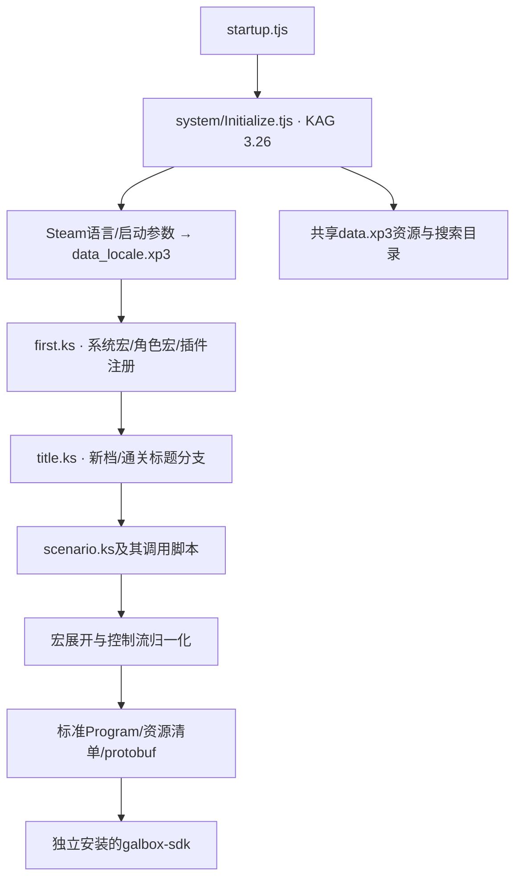

# KRKR2 / KAG3 组织分析与移植边界

以安装目录的源码、资源与公开格式为依据。遵从用户要求：不逆向exe；忠实还原原作表现，游戏画面只包含原作内容。没有对整作或原版存档兼容作完成声明。

## 已确认的启动与依赖链

- KRKR2提供TJS、图像/音频/文件、原生插件以及KAGParser等基础设施；这里的KAG3系统脚本通过BaseConductor继承KAGParser、用getNextTag分发标签。不是每个KS标签都对应一个原生引擎指令。
- Initialize.tjs读取`-language`或Steam.getLanguage，规范成en/fr/it/jp/ko/pt-br/ru/zh；添加语言包及bgimage/fgimage/bgm/scenario/system等路径。不能只合并游戏文本，语言包还覆盖菜单、图像和系统脚本。
- first.ks注册macro.ks、角色图层/动作、声音、菜单、历史等定制。未知TJS、动态宏与原生插件需要逐项分析映射，不能直接执行脚本或静默省略。
- title.ks根据sf.scenario1/sf.fataend选择标题；当前仅处理新档title_main的源淡入/循环钢琴/规则菜单，非通关标题。不同语言的按钮目标/文字也有差异，不能从hint反推动作。
- 原作800×600。Config默认marginL=70，MessageLayer.locate会额外加marginL，故标题x=535的按钮实际位于605。不能把标签数字直接当最终屏幕坐标。
- 正文jinobun、gray、draw_name、c、center_pos控制姓名、颜色、位置与居中。空姓名不是一个占位名字；西文draw_name仍locate y=42。中日两次换行与西文字号/行距不同。字体应按原Config选择，位图预渲染.tft还有待支持。

## 可复用的适配分层

1. **资源读取**：XP3索引/分段/压缩、字符编码、大小/校验与版本指纹；共享包和语言覆盖目录分别保留。源码目录只读。
2. **KAG前端**：词法、源位置、标签/宏定义、调用关系、条件/表达式和参数展开，形成AST与符号表。前端已依据公开KAGParser实现支持反引号转义、裸true属性、参数模式与重复属性的顺序覆盖，保留每次输入。701份KS可生成原始控制IR；宏模板不预先强求if平衡，结构化子树在展开/CFG阶段建立。完整执行语义仍未完成。
3. **作品配置**：这作的宏语义、系统变量、资源搜索顺序、图层/角色/菜单约定。原始标签不是一律文本替换。其他作品复用前端，提供各自宏配置。
4. **语义降低**：把确认过的操作变成port-kit真实工厂/稳定地址，输出能力与unsupported报告、资源事实及protobuf。跨语言保留原标签，但重复标签必须带作用域/出现序号；当前仅验证开场22个GUID一致，不能扩成全作按行对齐。
5. **执行与恢复**：同一个正式SDK Core/Coordinator/Host/Storage负责剧情与存档。实例只实现源适配和原作UI；Core没有作品ID分支，不建立另一个KAG解释器。

原版存档之后需要分析KAGParser.store/宏栈、KAG系统书签及sf/global等闭包，再做明确版本的codec/mapping；不能把网页快照当原版存档。

## 当前表现与已知差异

标题、原按钮和系统菜单、44段静态前导/OP、22页序言与完整新周目序章均使用同一正式SDK路径。zero2→scenario1start按sf.fataend=0编译，保留两条问候分支、女仆部件/表情、正常对白、版本化流式BGM、具名炉火/脚步SE和源转场。React只提交Player动作，不执行KAG或改PC。

第一门全文、原章节回放、角色移动和有限环境效果已接正式SDK。正文框/姓名独立对象与早期合成图的无框变体共同由SDK临时投影隐藏；显示图走独立目录，不改变Core或存档签名。原设置/富历史/取消与隐藏见[本轮验收](evidence/INTERFACE_COMPLETION.md)。第二门及完整通关变体、日中.tft、原作精确存档/原生运行对照仍未完成。

完整支持集及已知旧32页自动迁移及未知版保留规则见[PROLOGUE_SCOPE](PROLOGUE_SCOPE.md)。下列增量段落记录历史实现，不代表当前完成范围。

公开参考仅辅助核对格式和语言分层：[XP3源码](https://github.com/krkrz/krkrz/blob/master/base/XP3Archive.cpp)、[KAGParser源码](https://github.com/krkrz/KAGParser)、[KAG标签参考](https://a-rabin.github.io/krkr2doc-en/kag3doc/contents/Tags.html)。本作的组织和定制以本地提取源码为准。

## 本轮前端增量

2026-10-28：KAGParser公开源码核实了属性名小写、反引号转义、裸true、&/%前缀、字典顺序覆盖及重复标签:2/:3别名。宏记录不应强制模板内部条件平衡；本作if_experienced/ifflag等确实只记录if前半段。部分源控制流还依赖跳转/返回，不能只以全文件括号配对判语法有效性。

新增parseKag提供结构化封闭子树和raw控制IR两种模式，保留宏模板、源位置、嵌入TJS（不执行）及原生标签别名。analyze:kag对8语言701份KS生成3337个宏定义候选和调用/插件依赖线索，全部文件可保留；这不是宏注册顺序已求值或完整CFG已解决。资料仍只写ignored artifacts/ast。

新增literal文本流下沉：l→SDK richText.confirm，r→换行，保留字面正文并拒绝动态表达式/未知控制。实际8语言源段落已通过Core、同页确认/页尾历史及protobuf等待点恢复；当前production开场转换器也共用该下沉路径。没有为了演示控制而在原始22页中插入不存在的[l]。

## 标题演出降低

2026-10-28：title.ts验证新档有限标签/参数、3秒背景crossfade→playbgm→2.5秒universal+wt顺序，并拒绝未知指令、动态内容或不同静态页profile。KAGLayer.tjs的children默认true；本段背景不变，仅菜单子层在原top=30位置出现。转换器先构成800×600完整静态目标页，SDK规则图在整页坐标实时转换，不将规则随菜单局部位移，也不预录动画。动态children仍需单独语义，不能据此称通用层聚合已完成。

音轨采用公开audioTrack的element/loop/replay路径；没有把原长曲降采样成短测试片段。手势解锁与媒体自然状态由SDK负责。标题按钮向Core提交正式choice；没有React推进PC。开始离场/44静态前导与原OP歌曲已沿此路径接通；后续普通对话/菜单仍逐段实现。

资产转码按实际编码后摘要命名、strip非确定元数据，全语言完成后验证每个Program的资源闭包。release纳入完整Program/资产身份，避免不同内容沿用同一release。原始图片/声音/脚本仍只保留在ignored路径。

## 原作音乐、SE与静态前导

SDK实包新增uiSound/Player.playUISound请求与有界装置控制器；本实例只将原按钮enterse/clickse声明为请求，不复制音效播放器。UI与剧情SFX/音轨分离，加载/恢复不复活旧cue。长钢琴/OP歌以element和明确replay策略执行，master/sfx/BGM偏好仍由SDK持久管理。

静态前导维护fore/back/children/backlay/可见性/既有位置，只支持源中已核实的页面配置；44效果与等待降低到公开舞台/音轨工厂。known setup完整保留，未支持的菜单/glyph/textfade/click-skip列deferred；动态属性、未知TJS或ASD拒绝。原歌曲延续至22页后fadeout，并非开始动作立刻stop。

新资产/源时间与实际Core trace均验；按最终编码摘要命名并在全部语言后复验发布闭包。并发音效通过Promise memo避免重复注册。balanced/64MiB是本实例策略，不改变SDK四种加载策略。当前源fadeout以bus归零近似，G3-07负责按源结束停止与多个剧情SE buf；不用UI cue承接可保存的环境声。

## 首页与后台策略增量

原title_main全部可见命中区已接：读取/设置为临时UI，原Core仍等待choice；Player负责设置持久与真实存读档。原opt/saveload图与布局保留，复杂TJS只读其已确认数据，不执行。JS不修改PC、profile或强塞存档结果。新增浏览器禁止contextmenu/selectstart/拖图，键盘/滑条/焦点仍按各控件处理。

SDK backgroundPlayback让演出/媒体在失焦/隐藏后继续并取消Auto；普通文字停下一输入点，不在focus时恢复Auto。隐藏timer与RAF互斥，媒体增益更新与绘制拆开，显式暂停保持权威。开发hmr=false另解决改码导致会话重建，实际源码/资源写入验证无重载；浏览器节流/OS挂起仍不作硬实时承诺。

当前新增zero2前10页的显式fresh-profile编译：条件只接纳sf.fataend==1/!=1，不执行TJS；source/PO按稳定标签匹配。w宏单位从各语言声明读取（8/12），通过正式SDK字符等待降低；灰字/斜体/法国accent缩放和固定wait保留。4秒背景与BGM淡出并行，消息框来自原资源。当前未进入第一次炉火playse及角色立绘，不能据此宣称完整普通对话。

G1-04滚轮由正式SDK InputController处理，实例只attachInput到包含点击覆盖层的游戏根。历史UI订阅Player.backlog并调用showSystemScreen，不复制Core历史、伪造切点或修改PC。history背景/关闭按钮和各语边距来自源配置，ui.po同步三项标签。menus:refresh单独更新标题/菜单元数据，16份剧情Program/Release保持旧字节；避免界面改动误伤存档兼容。当前加载策略已改demand/64MiB、长音乐versioned-url；上文balanced/完整Blob为历史实现。
